# c99gui — Four Pure C99 GUI Programs

A collection of four single-file, zero-allocation GUI programs in portable C99. Each program is self-contained with zero third-party library dependencies: a terminal UI, a pixel GUI, a vector GUI and a five-workspace vector suite.

<p align="center">
  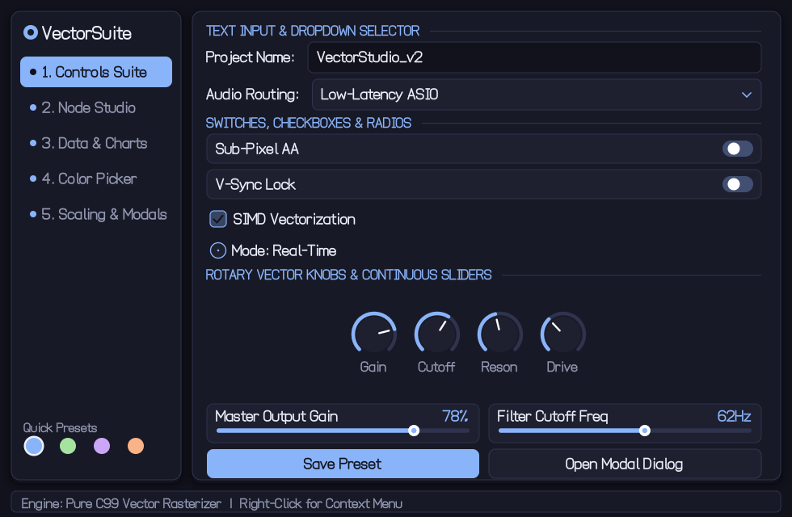
  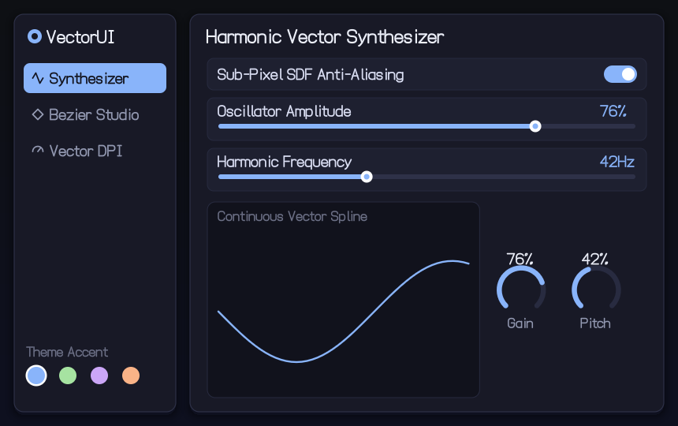
</p>

All screenshots on this page are frames rendered by the programs themselves with `--snapshot` from the current sources.

## Downloads

Prebuilt binaries are on the [Releases](https://github.com/Foadsf/c99gui/releases) page. Each archive holds all four programs as single self-contained executables, plus this README and the license:

| Archive | Platform | What makes it portable |
|---|---|---|
| `c99gui-<version>-linux-x64.tar.gz` | Linux x86-64 | Fully static (musl libc, X11 linked in); runs on any distribution with an X server, no libX11 install needed |
| `c99gui-<version>-linux-arm64.tar.gz` | Linux ARM64 (e.g. Raspberry Pi 4/5 64-bit, Graviton) | Same, for ARM64 |
| `c99gui-<version>-macos-universal.tar.gz` | macOS 11+ on Apple Silicon and Intel | One universal binary per program; system frameworks only |
| `c99gui-<version>-windows-x64.zip` | Windows x64 | Static C runtime; needs only `KERNEL32`, `USER32`, `GDI32` |
| `c99gui-<version>-windows-x86.zip` | Windows 32-bit | Same, 32-bit |
| `c99gui-<version>-windows-arm64.zip` | Windows on ARM | Same, native ARM64 |

`SHA256SUMS.txt` lists the checksums of every archive. The macOS binaries are not signed: clear the quarantine flag with `xattr -d com.apple.quarantine c99gui-*` before the first run. The three desktop GUIs also run without a display: `--test`, `--snapshot` and `--headless` work over SSH or in CI.

## The Four Programs

### 1. c99gui-tui (Terminal UI)

**Source:** `src/tui/c99gui.c`  
**Dependencies:** None (standard C library only)  
**Status:** ✅ CI builds and tests on all platforms

A zero-allocation, immediate-mode terminal GUI in C99. Uses a software framebuffer of UTF-8 cells with 24-bit color. All state lives in static storage — no heap allocations.

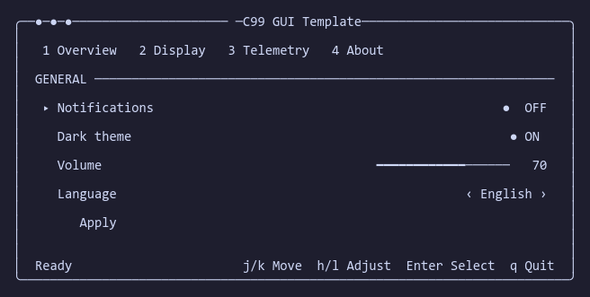

*The `--snapshot` text frame; in a terminal the UI is drawn in 24-bit colour.*

**Build:**
```sh
cc -std=c99 -O2 -Wall -Wextra -pedantic src/tui/c99gui.c -o c99gui-tui
cl /std:c11 /W4 /O2 /MT /utf-8 src\tui\c99gui.c /Fe:c99gui-tui.exe
```

**CLI:** `--help`, `--version`, `--snapshot` (reads keys from stdin, prints the final 80x24 frame as plain text), `--256` (force the 256-colour palette; `C99GUI_COLOR=256|truecolor` also works)

---

### 2. c99gui-pixel (Pixel Desktop GUI)

**Source:** `src/pixel/gui.c`  
**Dependencies:** Win32 GDI (Windows), X11 (Linux), Cocoa/CoreGraphics (macOS), or headless  
**Runtime:** the release binaries are self-contained (see [Downloads](#downloads)); a Linux build you compile yourself links `libX11` dynamically  
**Status:** ✅ CI compiles the Win32, X11 and Cocoa backends and runs the headless tests on all platforms

A monolithic pixel-rendered desktop GUI with a 32-bit ARGB software rasterizer, sub-pixel anti-aliased rounded rectangles, alpha blending, soft drop shadows, and the public-domain VGA 8x16 font. The window is resizable and maximizable (minimum 640x450); the layout reflows from the live window size.

<p>
  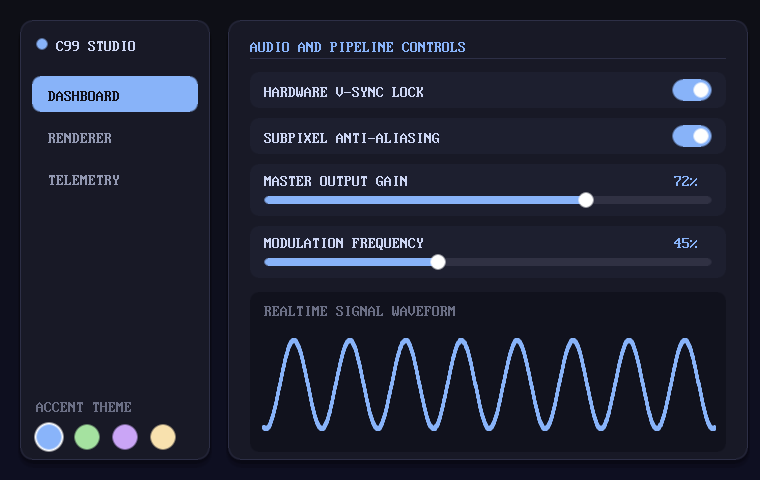
  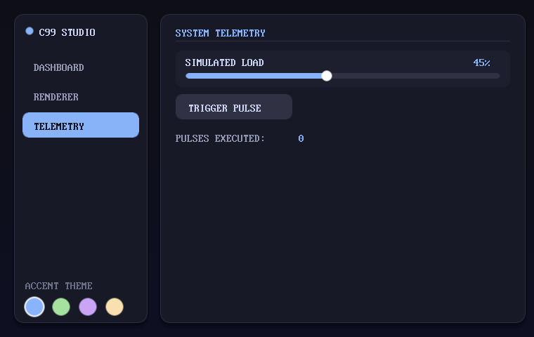
</p>

**Build:**
```sh
# Windows (MinGW/MSYS2)
gcc -std=c99 -O2 -Wall -Wextra -pedantic src/pixel/gui.c -lgdi32 -luser32 -o c99gui-pixel.exe

# Linux (X11)
cc -std=c99 -O2 -Wall -Wextra -pedantic src/pixel/gui.c -lX11 -o c99gui-pixel

# macOS
cc -std=c99 -O2 -Wall -Wextra -pedantic src/pixel/gui.c -framework Cocoa -framework CoreGraphics -o c99gui-pixel

# Headless (testing)
cc -std=c99 -O2 -DC99GUI_HEADLESS src/pixel/gui.c -o c99gui-pixel
```

**CLI:** `--help`, `--version`, `--test`, `--snapshot FILE.bmp`, `--headless`, `--size WxH`, `--tab N`

---

### 3. c99gui-vector (Vector Desktop GUI)

**Source:** `src/vector/gui.c`  
**Dependencies:** Win32 GDI (Windows), X11 (Linux), Cocoa/CoreGraphics (macOS), or headless  
**Runtime:** the release binaries are self-contained (see [Downloads](#downloads)); a Linux build you compile yourself links `libX11` dynamically  
**Status:** ✅ CI compiles the Win32, X11 and Cocoa backends and runs the headless tests on all platforms

A resolution-independent SDF and Bézier vector graphics engine with SVG-style quadratic Bézier typography, sub-pixel anti-aliasing, and real-time DPI scaling (0.75x – 1.30x). The window is resizable and maximizable (minimum 640x400).

<p>
  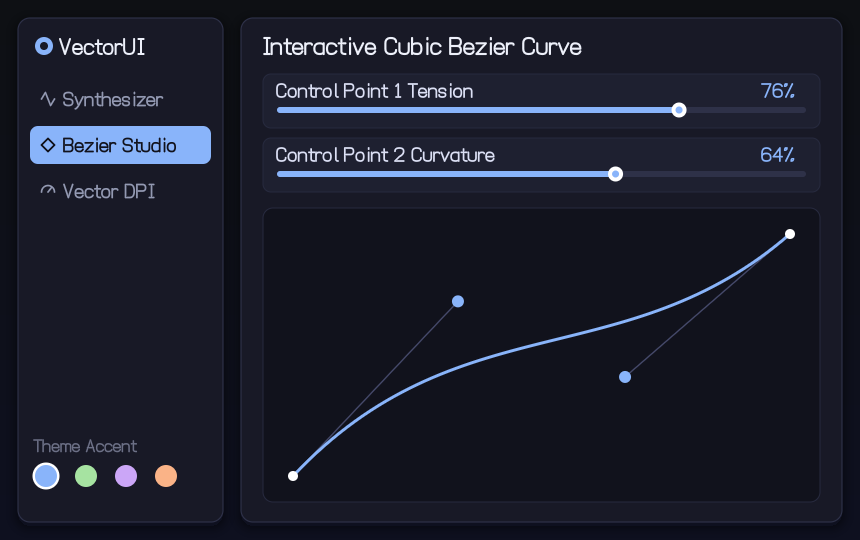
  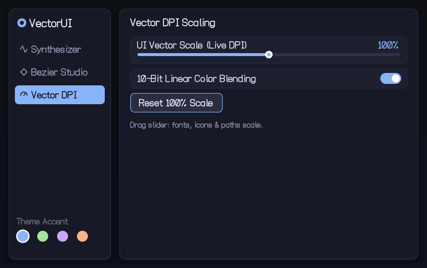
</p>

The same tab laid out at the 640x400 minimum and at 1280x560:

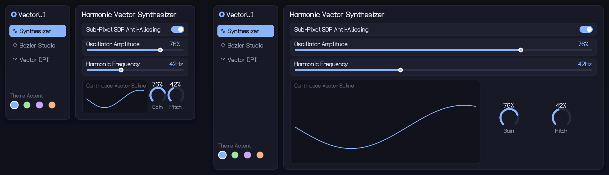

**Build:**
```sh
# Windows (MinGW/MSYS2)
gcc -std=c99 -O2 -Wall -Wextra -pedantic src/vector/gui.c -lgdi32 -luser32 -o c99gui-vector.exe

# Linux (X11)
cc -std=c99 -O2 -Wall -Wextra -pedantic src/vector/gui.c -lX11 -o c99gui-vector

# macOS
cc -std=c99 -O2 -Wall -Wextra -pedantic src/vector/gui.c -framework Cocoa -framework CoreGraphics -o c99gui-vector

# Headless (testing)
cc -std=c99 -O2 -DC99GUI_HEADLESS src/vector/gui.c -o c99gui-vector
```

**CLI:** `--help`, `--version`, `--test`, `--snapshot FILE.bmp`, `--headless`, `--size WxH`, `--tab N`

---

### 4. c99gui-suite (Comprehensive Vector GUI Suite)

**Source:** `src/suite/gui.c`  
**Dependencies:** Win32 GDI (Windows), X11 (Linux), Cocoa/CoreGraphics (macOS), or headless  
**Runtime:** the release binaries are self-contained (see [Downloads](#downloads)); a Linux build you compile yourself links `libX11` dynamically  
**Status:** ✅ CI compiles the Win32, X11 and Cocoa backends and runs the headless tests on all platforms

A comprehensive vector GUI framework with five interactive workspaces: Controls Suite, Node Studio, Data & Charts, Color Picker, and Scaling & Modals. Features scrollable containers, multi-column layouts, animated widgets, dropdown menus, modal dialogs, and toast notifications. The window is resizable and maximizable (minimum 640x400).

<p>
  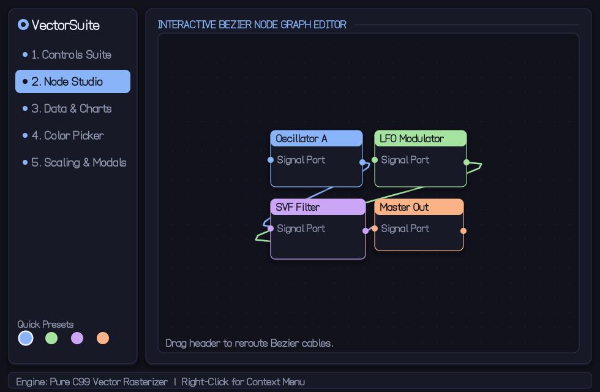
  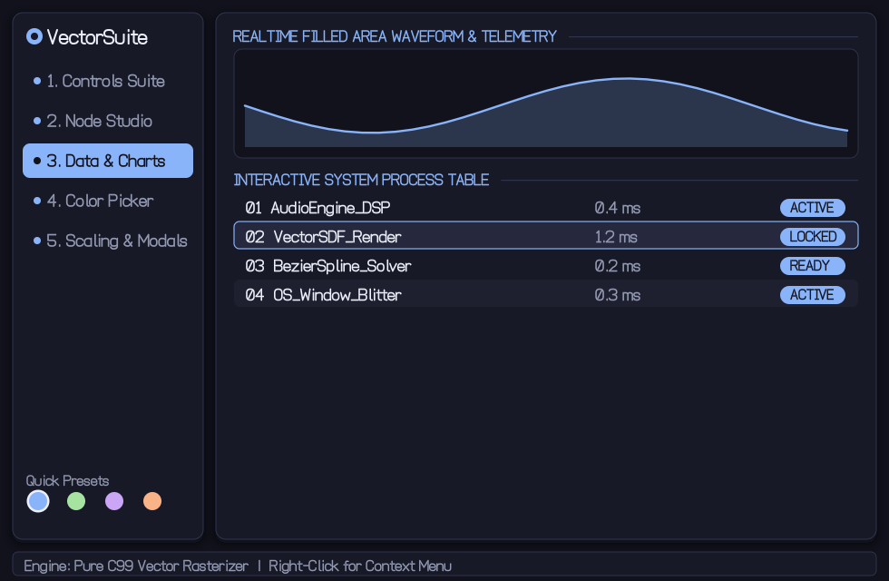
</p>
<p>
  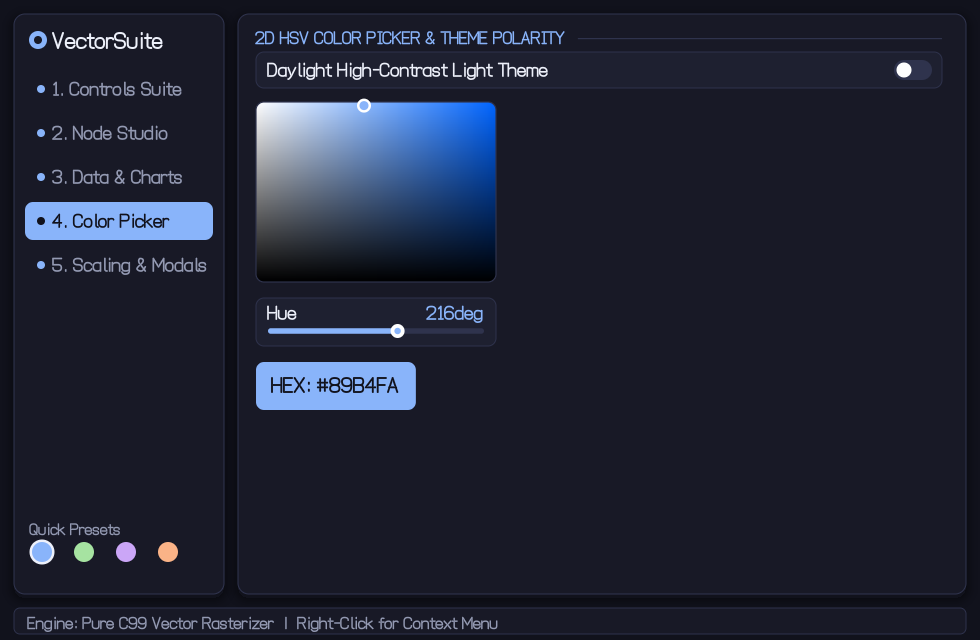
  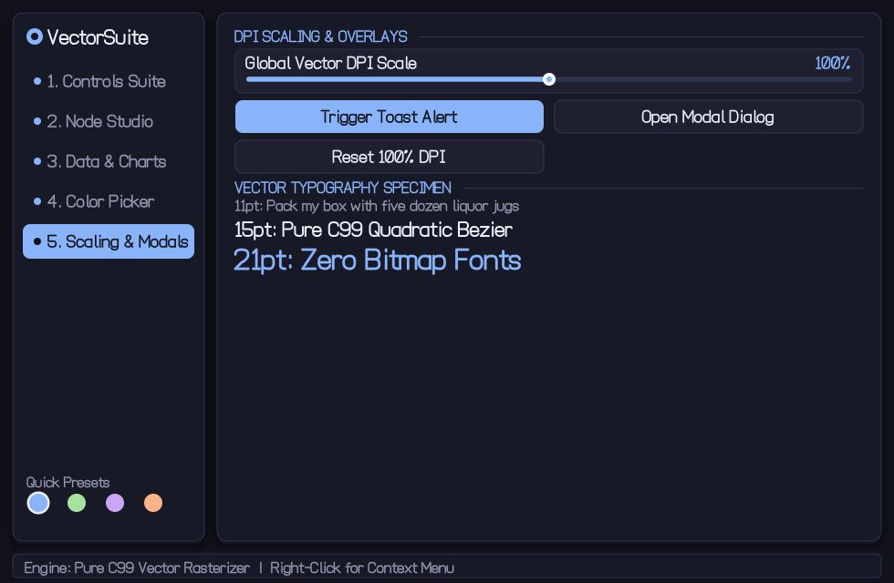
</p>

**Build:**
```sh
# Windows (MinGW/MSYS2)
gcc -std=c99 -O2 -Wall -Wextra -pedantic src/suite/gui.c -lgdi32 -luser32 -o c99gui-suite.exe

# Linux (X11)
cc -std=c99 -O2 -Wall -Wextra -pedantic src/suite/gui.c -lX11 -o c99gui-suite

# macOS
cc -std=c99 -O2 -Wall -Wextra -pedantic src/suite/gui.c -framework Cocoa -framework CoreGraphics -o c99gui-suite

# Headless (testing)
cc -std=c99 -O2 -DC99GUI_HEADLESS src/suite/gui.c -o c99gui-suite
```

**CLI:** `--help`, `--version`, `--test`, `--snapshot FILE.bmp`, `--headless`, `--size WxH`, `--tab N`

---

## Quick Build Reference

| Toolchain | Command |
|---|---|
| **Make** | `make` (builds all four), `make test`, `make headless` |
| **CMake** | `cmake -B build && cmake --build build` |
| **Windows (MSVC)** | `build.cmd` or `build.cmd headless` |
| **Windows (MSYS2)** | `pwsh scripts/build-matrix.ps1` |

## Command-Line Options (GUI Programs)

```sh
./c99gui-pixel --help             # Print command-line options
./c99gui-pixel --version          # Print version
./c99gui-pixel --test             # Run automated headless regression test suite
./c99gui-pixel --snapshot out.bmp # Render one frame, export to 32-bit BMP, exit
./c99gui-pixel --headless         # Run simulation frames without opening a window
./c99gui-pixel --snapshot out.bmp --size 1280x720 --tab 1   # One frame of tab 1 at 1280x720
```

`--test` checks every recorded widget rectangle (and, in vector and suite, every text rectangle, plus sibling overlap) against the window and its parent on every tab at the minimum size and at 1920x1080. With `C99GUI_TEST_NEGATIVE=1` it renders below the minimum and must report real failures; `tests/smoke.sh` requires that.

## Command-Line Options (TUI)

```sh
./c99gui-tui --help               # Print command-line options
./c99gui-tui --version            # Print version
echo j | ./c99gui-tui --snapshot  # Feed keys on stdin, print the final 80x24 frame as text
```

## Verification

Run the smoke tests against built binaries:
```sh
sh tests/tui_smoke.sh build/c99gui-tui
sh tests/smoke.sh build/c99gui-pixel
sh tests/smoke.sh build/c99gui-vector
sh tests/smoke.sh build/c99gui-suite
```

## CI Status

GitHub Actions builds all four programs on:
- **Linux** (Ubuntu): GCC and Clang, X11 and headless modes
- **macOS**: Clang, Cocoa and headless modes  
- **Windows**: MSVC (x64) and MSYS2 UCRT64 GCC, default and headless modes

CI compiles with platform backends (X11, Cocoa, GDI) and runs headless tests (`--test`, `--snapshot`). Window creation cannot be tested on CI runners.

All builds use strict warnings: `-Wall -Wextra -Wpedantic -Wconversion -Wshadow -Werror` (GCC/Clang) or `/W4 /WX` (MSVC).

## License

MIT License. See [LICENSE](LICENSE).
